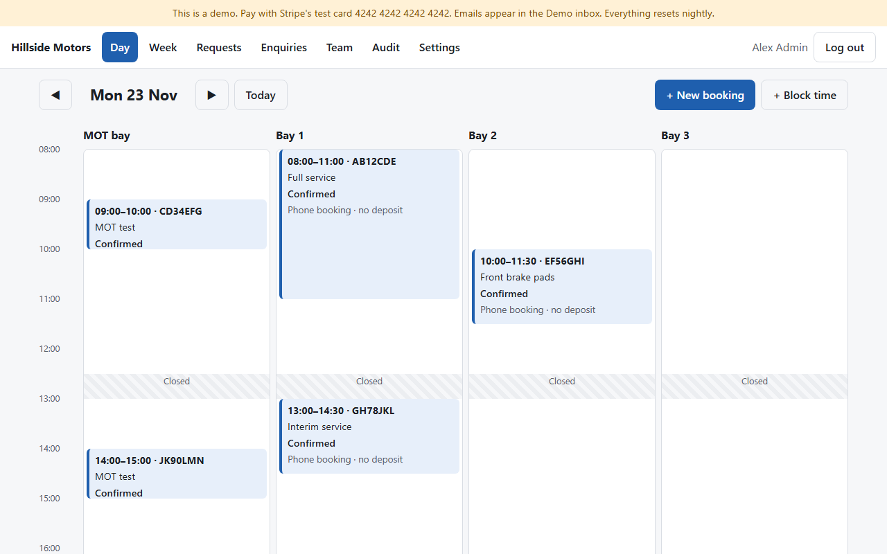
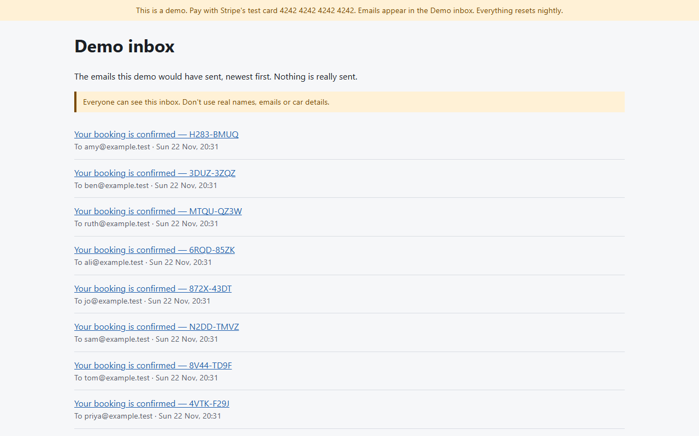
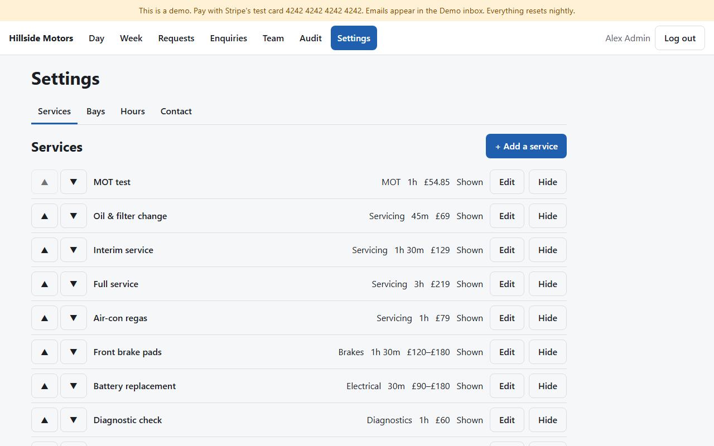
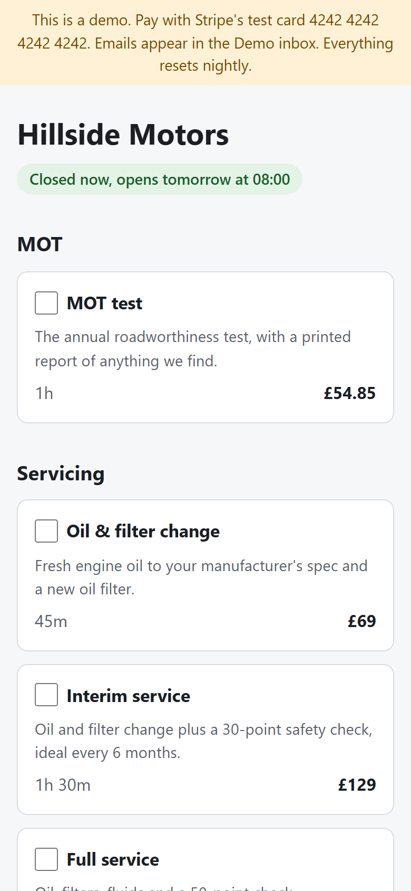

# Garage Booking

**Live demo: <https://garage-demo.duckdns.org>**

An online booking system for a car repair garage. Customers pick services, choose a free time
and pay a deposit. The garage's staff run the day from a back office: a schedule by bay, phone
bookings, approvals, enquiries and settings. It's a full-stack app (React, FastAPI,
PostgreSQL) with Stripe payments, emails, a background worker, and HTTPS hosting on a free
cloud server.

| Choosing services | Picking a time |
| --- | --- |
|  |  |
| **Staff day view** | **Demo inbox** |
|  |  |
| **Admin settings** | **On a phone** |
|  |  |

## What it does

### For customers

- Book one or more services. Only times when a suitable bay is free are offered, and a time is
  held for you while you fill in your details.
- Pay a £20 deposit with Stripe's card form, embedded in the page.
- Get a confirmation email with a private link to view or cancel the booking (a refund if it's
  more than 24 hours ahead), plus a reminder 48 hours before.
- Request services that need the garage's approval, or describe a problem in an enquiry.

### For staff

- A day and week schedule across every bay.
- Book phone customers, block time, move or cancel bookings (the customer is emailed, and
  the deposit refunded), and track jobs through in progress, completed or no-show.
- Approve or decline online requests, and turn enquiries into bookings.

### For admins

- Edit services, bays, opening hours and contact details. A change that would clash with
  existing bookings is refused, and the bookings in the way are listed.
- Invite staff, manage their access, and read an audit log of every staff change.

## Try the demo

- **Pay** with Stripe's test card `4242 4242 4242 4242`, any future date and any CVC. No real
  money moves.
- **Emails** aren't sent. They appear in the public **Demo inbox** (linked in the footer), so
  use made-up details.
- **Staff side:** go to `/staff` and log in as `admin@example.test` / `demo-admin-pass` (or
  `staff@example.test` / `demo-staff-pass` for the staff view).
- **Everything resets** at 03:00 UK time every night.

A quick tour: book an MOT and pay, open the confirmation in the Demo inbox, log in as the
admin and find the booking on the day view, move it to another time, then see the "moved"
email in the inbox.

## How it's built

| Part | Tools |
| --- | --- |
| Frontend | React 19, TypeScript, Vite, React Router, Stripe.js |
| Backend | Python 3.13, FastAPI, SQLAlchemy, Alembic, a background worker for holds, emails and clean-up |
| Database | PostgreSQL |
| Payments | Stripe Checkout (embedded) and webhooks, test mode |
| Testing | pytest with Testcontainers (1,000+ tests), Vitest (370+), Playwright end-to-end flows with axe accessibility checks |
| CI | GitHub Actions: lint, type checks, tests, the full Docker stack end to end, dependency and image scans (pip-audit, npm audit, Trivy) |
| Hosting | Docker Compose on an Oracle Cloud Always Free Arm server, nginx, Caddy for automatic HTTPS |

Some details worth a look:

- **No double bookings.** A PostgreSQL exclusion constraint stops two bookings from
  overlapping on the same bay, even when two customers click at the same moment. Times are
  held while customers type and pay, and expired holds are released by the worker.
- **Payments checked with Stripe.** A booking is only confirmed once Stripe says it's paid,
  through its webhook or by the server asking Stripe directly, never on the browser's word.
  Abandoned payment forms are closed, and cancellations refund the deposit automatically.
- **Reliable email.** Emails are queued in the database and sent by the worker, with retries.
- **Security.** Rate limits and login lockout per visitor (the real address, which can't be
  faked through proxy headers), a honeypot on public forms, a strict content security policy,
  server-side staff sessions, and an audit trail.
- **Privacy.** A privacy note, and a daily job that removes customers' personal details 12
  months after their appointment.
- **Built in milestones** from a written [specification](docs/SPEC.md), each with a design, a
  plan and a definition of done.

## Run it locally

Prerequisite: [Docker Desktop](https://www.docker.com/products/docker-desktop/).

```bash
docker compose up --build
```

Then open <http://localhost:8080>. With no Stripe keys, payments run in demo mode (a "Pay
£20 (demo)" button), and emails are caught by [Mailpit](http://localhost:8025). The staff side is at
<http://localhost:8080/staff>, with the same logins as the live demo.

## Documentation

- [Development guide](docs/development.md): running, testing and operating the app
- [Specification](docs/SPEC.md)
- [Deploying the live demo](docs/deployment.md)
- [Setting up Stripe (test mode)](docs/stripe-setup.md)
- [Implementation plans](docs/superpowers/plans/)
